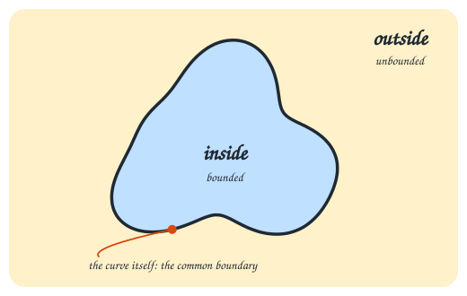
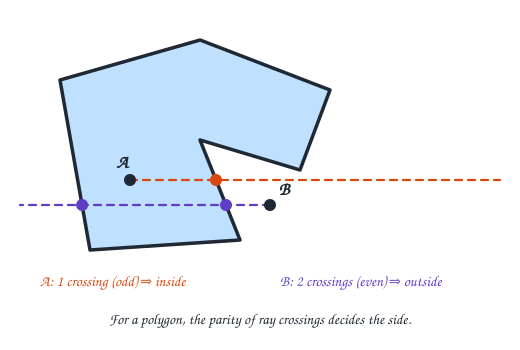
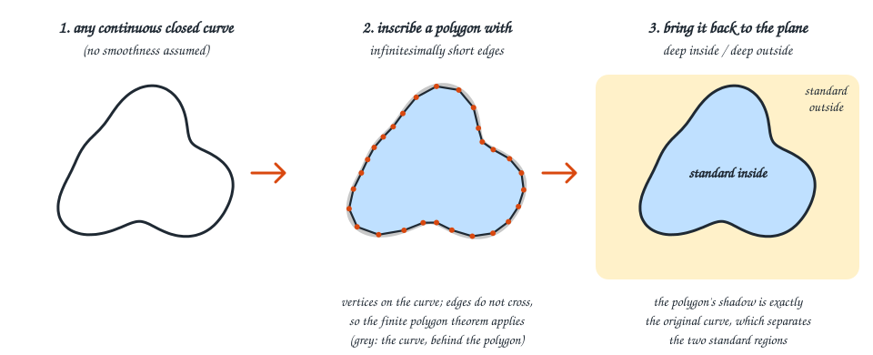
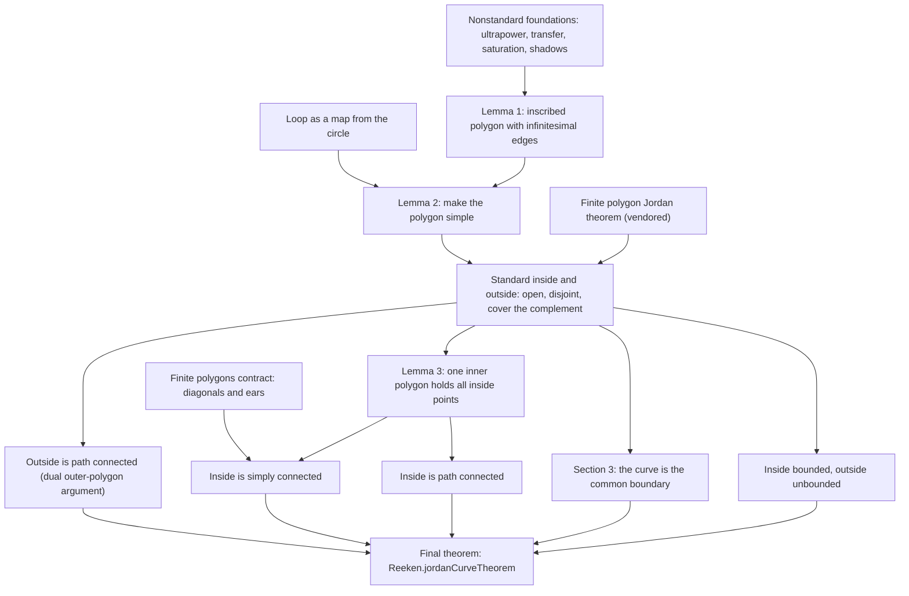

# The Jordan curve theorem, for humans

This page explains what this repository proves, why it is harder than it looks, how the
proof works, and why you can trust the result. It starts with pictures and ends with
the exact Lean statement. Stop reading wherever you have what you need.

**Reading paths**

| You have | Read |
| --- | --- |
| 2 minutes | [The theorem in one picture](#1-the-theorem-in-one-picture) and [the idea in one picture](#3-the-idea-in-one-picture) |
| 20 minutes | Everything on this page, top to bottom |
| 2 hours | This page, then the [proof roadmap](#4-the-proof-roadmap) files in order, the [source correspondence](source-map.md), and the [NSA tooling guide](nonstandard-tooling.md) |

---

## 1. The theorem in one picture

Draw a closed loop on paper without lifting the pen and without crossing your own line.
The loop cuts the page into exactly two pieces: a bounded **inside** and an unbounded
**outside**, and the loop is the edge of both.



That is the Jordan curve theorem. This repository proves it in Lean 4 for **every**
continuous, non-self-intersecting loop in the plane. The proved statement also says
that the inside has no holes (it is *simply connected*): any loop drawn inside it can
be shrunk to a point without leaving it.

## 2. Why something so obvious is hard

"Continuous and non-self-intersecting" allows far stranger loops than anything you can
draw:

- The **Koch snowflake** is a Jordan curve with no tangent line at any point and
  infinite length. You cannot walk along it and "keep the inside on your left" in any
  naive sense.
- **Osgood** (1903) constructed Jordan curves of *positive area*. The curve itself is
  so wiggly that it occupies a region of the plane with positive area.

The theorem must cover all of these. Any proof that leans on smoothness, finite length,
or a picture fails. That is why the theorem is famous as an "obvious" result that
needs a genuinely careful proof.

For **polygons** the problem is much easier. To decide if a point is inside, shoot a
ray from it and count how many edges it crosses. An odd count means inside; an even
count means outside.



The strategy of the proof is to reduce the wild case to the polygon case.

## 3. The idea in one picture

Vladimir Kanovei and Michael Reeken's proof
([published paper](https://www.maths.ed.ac.uk/~v1ranick/jordan/jor.pdf), *Real Analysis
Exchange* 24(1), 161–170) uses **nonstandard analysis**, which provides genuine
infinitesimal numbers.



1. Start with an arbitrary continuous loop. Assume nothing else about it.
2. Inscribe a polygon whose vertices lie on the loop and whose edges are all
   **infinitesimally** short. Then clean it up so it does not cross itself. A
   non-self-intersecting polygon is easy to handle: it has an inside and an outside by
   the finite polygon theorem.
3. Bring that picture back to the ordinary plane. An ordinary point is in the
   **standard inside** when every point infinitely close to it is inside the polygon,
   and likewise for the outside. The points infinitely close to the polygon "shadow"
   onto exactly the original loop.

The remaining work, which is most of this repository, proves that these two standard
regions have every property the theorem promises: open, nonempty, path connected,
bounded or unbounded, with the loop as common boundary, and an inside with no holes.

## 4. The proof roadmap

Each box is one mathematical step. Arrows mean "is used by". The table below links the
Lean files for each step. The step names and files come from the
[README](../README.md) and the [source correspondence ledger](source-map.md).



| Step | Lean files |
| --- | --- |
| Loop as a map from the circle | [`CircleParametrization.lean`](../Reeken/Geometry/CircleParametrization.lean), [`SimpleLoop.lean`](../Reeken/Geometry/SimpleLoop.lean) |
| Nonstandard foundations | [`Ultrapower.lean`](../Reeken/Nonstandard/Ultrapower.lean), [`Hyperfinite.lean`](../Reeken/Nonstandard/Hyperfinite.lean), [`Saturation.lean`](../Reeken/Nonstandard/Saturation.lean), [`Metric.lean`](../Reeken/Nonstandard/Metric.lean), [`Shadow.lean`](../Reeken/Nonstandard/Shadow.lean) |
| Lemma 1: infinitesimal inscribed polygon | [`InitialPolygon.lean`](../Reeken/Nonstandard/InitialPolygon.lean), [`PolygonApproximation.lean`](../Reeken/Nonstandard/PolygonApproximation.lean), [`PolygonArcs.lean`](../Reeken/Nonstandard/PolygonArcs.lean) |
| Lemma 2: simple approximation | [`SimpleApproximation.lean`](../Reeken/Nonstandard/SimpleApproximation.lean) |
| Finite polygon Jordan theorem | [`PolygonSeparation.lean`](../Reeken/Geometry/PolygonSeparation.lean), [`vendor/`](../vendor/README.md) |
| Standard inside and outside | [`Regions.lean`](../Reeken/Nonstandard/Regions.lean), [`StandardRegions.lean`](../Reeken/Nonstandard/StandardRegions.lean) |
| Bounded inside, unbounded outside | [`ExteriorBounds.lean`](../Reeken/Geometry/ExteriorBounds.lean), [`RegionBounds.lean`](../Reeken/Nonstandard/RegionBounds.lean) |
| Section 3: common boundary | [`CommonBoundary.lean`](../Reeken/Nonstandard/CommonBoundary.lean) |
| Lemma 3: simultaneous containment | [`RingContainment.lean`](../Reeken/Nonstandard/RingContainment.lean) |
| Inside path connected | [`InsideConnectivity.lean`](../Reeken/Nonstandard/InsideConnectivity.lean) |
| Outside path connected (dual outer-polygon argument) | [`OuterContainment.lean`](../Reeken/Nonstandard/OuterContainment.lean), [`OutsideConnectivity.lean`](../Reeken/Nonstandard/OutsideConnectivity.lean) |
| Finite polygon contraction | [`PolygonDiagonal.lean`](../Reeken/Geometry/PolygonDiagonal.lean), [`PolygonEars.lean`](../Reeken/Geometry/PolygonEars.lean) |
| Inside simply connected | [`LoopContraction.lean`](../Reeken/Nonstandard/LoopContraction.lean), [`SimplyConnected.lean`](../Reeken/Nonstandard/SimplyConnected.lean) |
| Final theorem | [`Jordan.lean`](../Reeken/Jordan.lean) |

The [source correspondence ledger](source-map.md) has a row-by-row map at much finer
grain, about sixty steps.

## 5. Nonstandard analysis, gently

**What it is.** Nonstandard analysis enlarges the real numbers with infinitesimals (positive
numbers smaller than every ordinary positive real) and their reciprocals, the
unlimited numbers. It is fully rigorous; it is not a heuristic.

**How this repo builds it.** No new axioms are added. A "nonstandard" object is a
*sequence* of ordinary objects, and two sequences count as equal when they agree
"almost always", where an
[ultrafilter](https://en.wikipedia.org/wiki/Ultrafilter) decides what "almost always"
means. Mathlib already has this construction as `Filter.Germ`; the repository's
extension is just that:

```lean
/-- The extension of a type over the ultrafilter `U`. -/
abbrev Star (U : Ultrafilter ι) (α : Type v) := Germ (U : Filter ι) α
```

([`Ultrapower.lean`](../Reeken/Nonstandard/Ultrapower.lean)). The sequence
1, 1/2, 1/3, … then names an infinitesimal. "Infinitely close" is defined directly:

```lean
/-- Two internal points are close at every positive standard metric scale. -/
def Near [PseudoMetricSpace α] (x y : Star U α) : Prop :=
  ∀ ε : ℝ, 0 < ε → Germ.LiftRel (fun a b ↦ dist a b < ε) x y
```

([`Metric.lean`](../Reeken/Nonstandard/Metric.lean)). The regions of the final theorem
are defined from a sequence `p` of ever-finer polygons as points "deep" in the polygons'
insides or outsides, which means no point of the opposite side is infinitely close:

```lean
def standardInside : Set Schoenflies.Plane := deep (fun i ↦ Schoenflies.inside (p i).trace)

def standardOutside : Set Schoenflies.Plane := deep (fun i ↦ Schoenflies.outside (p i).trace)
```

([`StandardRegions.lean`](../Reeken/Nonstandard/StandardRegions.lean)).

**Why use it here.** A classical proof would approximate the curve by a sequence of
polygons and keep careful track of how errors shrink. With an infinitesimal polygon
there is one polygon whose edges are infinitely close to the curve, so many
epsilon-management steps become a single statement of the form "these are infinitely close".
The finite polygon theorem applies to that one polygon by **transfer**: facts true for
all finite polygons remain true in the extension.

## 6. The final statement, line by line

From [`Reeken/Jordan.lean`](../Reeken/Jordan.lean):

```lean
theorem jordanCurveTheorem
    (r : Metric.sphere (0 : EuclideanSpace ℝ (Fin 2)) 1 → EuclideanSpace ℝ (Fin 2))
    (hcont : Continuous r) (hinj : Function.Injective r) :
    ∃ inside outside : Set (EuclideanSpace ℝ (Fin 2)),
      inside.Nonempty ∧ outside.Nonempty ∧
      IsOpen inside ∧ IsOpen outside ∧ Disjoint inside outside ∧
      inside ∪ outside = (Set.range r)ᶜ ∧
      IsPathConnected inside ∧ IsPathConnected outside ∧
      Bornology.IsBounded inside ∧ ¬ Bornology.IsBounded outside ∧
      frontier inside = Set.range r ∧ frontier outside = Set.range r ∧
      IsSimplyConnected inside := by
```

| Lean | Plain English |
| --- | --- |
| `r : Metric.sphere (0 : …) 1 → EuclideanSpace ℝ (Fin 2)` | `r` places each point of the unit circle in the plane; its image is the curve. |
| `hcont : Continuous r` | The curve is drawn without lifting the pen. |
| `hinj : Function.Injective r` | It never touches itself: different circle points go to different plane points. |
| `∃ inside outside : Set …` | There exist two sets of points in the plane, such that: |
| `inside.Nonempty ∧ outside.Nonempty` | both actually contain points; |
| `IsOpen inside ∧ IsOpen outside` | each point of either region has a small disc around it in the same region; |
| `Disjoint inside outside` | no point is in both; |
| `inside ∪ outside = (Set.range r)ᶜ` | together they are exactly the points *not* on the curve; |
| `IsPathConnected inside ∧ IsPathConnected outside` | each region is one piece: any two of its points are joined by a path inside it; |
| `Bornology.IsBounded inside` | the inside fits in some disc; |
| `¬ Bornology.IsBounded outside` | the outside does not; |
| `frontier inside = Set.range r ∧ frontier outside = Set.range r` | the boundary of each region is exactly the curve; |
| `IsSimplyConnected inside` | the inside has no holes: every loop in it shrinks to a point within it. |

The hypotheses mention only the curve. Nothing about polygons, separation, or
approximation is assumed.

## 7. How do we know it's right?

You do not have to trust the authors or read the proof. Here is what the repository
and its CI actually check.

1. **Lean's kernel checks every step.** The theorem compiles only if each inference
   is valid. Proof modules contain no `sorry` (an "I'll prove it later" placeholder),
   no added axioms, and no `native_decide`.
2. **Axiom audit.** [`scripts/Audit.lean`](../scripts/Audit.lean) walks every
   declaration defined in the project and vendored modules, including private helpers,
   and fails unless each depends only on Lean's three standard axioms: `propext`,
   `Classical.choice`, and `Quot.sound`.
3. **Fresh kernel replay.** `lake env leanchecker --fresh Reeken` re-checks the entire
   imported environment from scratch.
4. **Independent statements, second kernel.** [`Verification/`](../Verification/)
   contains *challenge* files. Each states a result using only mathlib definitions, with
   no project definitions. The final
   [`JordanChallenge.lean`](../Verification/JordanChallenge.lean) has the same statement as
   above. A reader only needs to check that the challenge says the right thing.
   [Comparator](https://github.com/leanprover/comparator) checks that each solution
   proves the unchanged challenge with only the permitted axioms. It replays the proof in
   [**Nanoda**](https://github.com/robsimmons/nanoda_lib), an independent kernel implementation. Ten such targets cover the
   foundations, intermediate milestones, and the full theorem. The checker runs inside a
   [Landrun](https://github.com/zouuup/landrun) sandbox.
5. **Continuous integration.** Both run on every push:
   [Lean build, audit, and fresh replay](https://github.com/alok/JordanCurveTheorem/actions/workflows/lean.yml)
   and [Comparator and Nanoda](https://github.com/alok/JordanCurveTheorem/actions/workflows/comparator.yml).

To reproduce locally:

```sh
lake exe cache get
python3 scripts/check-solutions.py
lake env lean scripts/Audit.lean
lake env leanchecker --fresh Reeken
```

## 8. What is proved, and where it differs from the paper

**Proved:** the full theorem above, for every continuous injective map of the circle
into the plane. The [source ledger](source-map.md) records the status of each step of
the paper's argument.

**Borrowed, with attribution.** The paper *assumes* the Jordan theorem for polygons.
This project proves it instead, using finite polygon modules vendored from
[Álvaro Begué's schoenflies-lean](https://github.com/alonamaloh/schoenflies-lean)
(Apache 2.0). These modules are third-party proof code, not original project work. Only the finite polygonal part is used;
that project's general Jordan and Schoenflies assembly is excluded. See
[`vendor/README.md`](../vendor/README.md).

**Variations from the paper.** These are documented in the [source ledger](source-map.md):

- *Exterior connectivity.* The paper uses an inversion step. The formal proof instead
  reuses the infinitesimal-barrier argument on an outer polygon, the dual of the inside
  argument. It proves the same conclusion but does not formalize the inversion step.
- *Simultaneous containment (Lemma 3).* The formal proof uses finite crossing parity
  instead of classifying all ring domains.
- *Simple connectivity.* The proof covers arbitrary continuous loops, including
  self-intersecting ones, by placing each loop inside one finite polygon whose closed
  inside stays in the curve's inside, then contracting that polygon.
- *Typos corrected.* The published condition (†) omits the last vertex. The paper
  prints the Section 3 equal-distance condition with a minus sign where equality is
  meant. A foot-point index in Lemma 3 is also mislabeled. Each correction is justified
  in the ledger.

**Beyond the theorem.** The nonstandard machinery is packaged as a reusable library
(`import Reeken.Nonstandard`): internal sets, transfer tactics (`star_cases`,
`star_transfer`), saturation, and shadows. See the
[NSA tooling guide](nonstandard-tooling.md).

## Where to go next

- [`README.md`](../README.md): build instructions and the module map.
- [`docs/source-map.md`](source-map.md): every paper step mapped to Lean files, with justified corrections.
- [`docs/nonstandard-tooling.md`](nonstandard-tooling.md): the reusable NSA library.
- [`blueprint/`](../blueprint/README.md): a Verso blueprint linking the mathematical steps to checked declarations.
- The original complete proof, before the NSA refactor, is tagged
  [`first-complete-proof`](https://github.com/alok/JordanCurveTheorem/tree/first-complete-proof).
